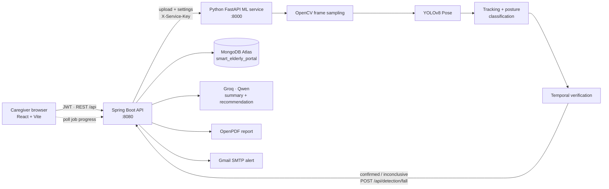

# Smart Elderly Fall Detection Portal

**Smarter Monitoring. Faster Response. Safer Lives.**

A full-stack elderly-safety system that detects falls in camera footage with YOLO Pose, verifies them over time before
raising an alarm, records confirmed incidents in MongoDB, writes an AI summary, produces a PDF report, emails caregivers,
and gives the care team a portal to acknowledge and resolve every incident.

---

## Contents
1. [Problem statement](#problem-statement)
2. [Features](#features)
3. [Architecture](#architecture)
4. [Technology stack](#technology-stack)
5. [Folder structure](#folder-structure)
6. [Setup](#setup)
7. [Environment variables](#environment-variables)
8. [Running the three services](#running-the-three-services)
9. [API reference](#api-reference)
10. [Database structure](#database-structure)
11. [How fall detection works](#how-fall-detection-works)
12. [Testing](#testing)
13. [Limitations](#limitations)
14. [Future enhancements](#future-enhancements)

---

## Problem statement

Falls are a leading cause of injury among older adults, and the time spent on the floor before help arrives strongly
affects the outcome. Continuous human observation is rarely possible. Simple motion or "horizontal body" alarms trigger
whenever someone sits or bends, so caregivers learn to ignore them.

This portal combines **pose estimation** with **temporal verification**: a potential fall is only confirmed when the
person *stays down* for a configurable period. Every alert carries its evidence (annotated frame, timeline, reasons), so
caregivers can judge it quickly.

## Features

| Area | What it does |
|---|---|
| **Fall detection** | OpenCV frame sampling → YOLOv8 Pose (17 keypoints) → per-person tracking → explainable posture classification (standing, walking, sitting, bending, lying, on the floor). |
| **Verification** | A potential fall must persist for the verification window (default 5 s). Getting up cancels it. A video that ends early, or a person who is barely visible, gives **INCONCLUSIVE**, never a false confirmation. |
| **Incidents** | Stored in MongoDB Atlas with an evidence frame, detection details, AI summary, PDF, email status and the acknowledge/resolve history. Creation is idempotent. |
| **AI summary** | Qwen on Groq writes a factual summary and caregiver recommendation *after* confirmation only. A deterministic fallback is used if Groq is unavailable. |
| **PDF reports** | OpenPDF report with branding, details, frame, summary, evidence, response timeline and a safety disclaimer. |
| **Email alerts** | Gmail SMTP with the PDF attached. Status is recorded honestly: `SENT` only after the SMTP server accepts the message. |
| **Portal** | Landing page, login/registration, dashboard with real statistics and service health, live monitoring with real progress, incident history (search, filter, sort, paginate, export CSV), incident details with acknowledge/resolve/false-alarm, reports and settings. |
| **Security** | BCrypt passwords, signed JWT sessions, admin/caregiver roles, a service key between backend and ML service, CORS allow-list, upload type and size limits, no secrets in code or logs. |

## Architecture



**Request flow for a video:**
1. React uploads the video to `POST /api/detection/jobs`. The backend checks the user's login, validates the file, and forwards it with the saved settings (threshold, verification window, resident, camera) to the ML service.
2. The ML service runs the job in the background. React polls `GET /api/detection/jobs/{id}` and shows the real stage, frame count and verification window.
3. On a confirmed fall, or an inconclusive one if enabled, the ML service calls `POST /api/detection/fall` with the shared service key. The backend stores the incident (idempotent on the job id), saves the frame, asks Groq for the summary, renders the PDF, and sends the email. Each step is isolated, so a Groq or SMTP failure never loses the incident.
4. The incident immediately appears on the dashboard and in the incident history.

> **Why the upload goes through Spring Boot** (the prototype called the ML service directly from the browser): it puts the
> ML service behind the portal's authentication, makes server-side settings apply to every analysis, and lets the browser
> talk to a single origin.

## Technology stack

| Layer | Technology |
|---|---|
| Frontend | React 19, Vite 8, React Router 7, Axios, Lucide icons, plain CSS (custom design system) |
| Backend | Java 21, Spring Boot 3.4, Spring Web, Spring Security (OAuth2 resource server with HS256 JWT), Spring Data MongoDB, Spring Mail, Bean Validation, OpenPDF |
| Database | MongoDB Atlas (`smart_elderly_portal`) |
| ML service | Python 3.11+, FastAPI, Uvicorn, OpenCV, Ultralytics YOLOv8n-pose, NumPy |
| AI | Groq API, Qwen model (`qwen/qwen3.8-27b` by default) |

## Folder structure

```text
├── .env.example              Template for all configuration (copy to .env)
├── backend/                  Spring Boot API
│   └── src/main/java/com/smartelderly/
│       ├── config/           AppProperties, SecurityConfig, StartupInitializer (indexes, bootstrap admin)
│       ├── controller/       Auth, Incident, DetectionJob, Portal (dashboard/reports/settings/health)
│       ├── dto/              Request/response records (no Mongo documents are exposed)
│       ├── exception/        ApiException + GlobalExceptionHandler (uniform JSON errors)
│       ├── model/            Incident, DetectionDetails, User, AppSettings, status enums
│       ├── repository/       Spring Data repositories
│       ├── security/         JwtTokenService, ServiceKeyFilter
│       └── service/          Incident, Dashboard, Settings, Groq, Pdf, Email, Storage, MlServiceClient, Health, Auth
├── ml-service/               FastAPI + YOLO Pose
│   ├── main.py               API endpoints
│   ├── jobs.py               Background jobs, progress, cancellation, backend reporting
│   ├── detector.py           Video pipeline, model manager, evidence frame
│   ├── fall_detector.py      Posture classification + temporal verification (explainable)
│   ├── tracker.py            Multi-person tracker
│   ├── api_client.py         POST /api/detection/fall with retries
│   ├── config.py             Environment configuration
│   └── tests/                Unit tests for the fall logic
├── frontend/                 React portal
│   └── src/ api/ auth/ components/ pages/ utils/ styles.css
└── docs/                     Viva / review notes
```

## Setup

### Prerequisites
- **Java 21+** and **Maven 3.9+**
- **Node.js 20+** (on Windows PowerShell use `npm.cmd` if script execution blocks `npm`)
- **Python 3.11+**
- A **MongoDB Atlas** cluster (or local MongoDB 6+). In Atlas, add your machine's IP under **Network Access**. If you use a VPN or Cloudflare WARP, your public IP changes; disable it or allow the relevant range.
- Optional: a **Groq API key** and a **Gmail App Password** (Google Account → Security → App passwords).

### Install

```powershell
# 1. Configuration
copy .env.example .env        # then fill in MONGODB_URI, JWT_SECRET, ML_SERVICE_API_KEY, ...

# 2. ML service
cd ml-service
py -m pip install -r requirements.txt

# 3. Frontend
cd ..\frontend
npm.cmd install

# 4. Backend (downloads dependencies on first build)
cd ..\backend
mvn -DskipTests package
```

The YOLO model `ml-service/yolov8n-pose.pt` is included; Ultralytics downloads it automatically if it is missing.

## Environment variables

All services read the project-root `.env`. Spring Boot imports it, and the ML service loads it with python-dotenv.
Real environment variables take precedence.

| Variable | Used by | Purpose |
|---|---|---|
| `MONGODB_URI`, `MONGODB_DATABASE` | backend | Atlas connection string and database name (`smart_elderly_portal`) |
| `JWT_SECRET`, `JWT_EXPIRATION_HOURS` | backend | Token signing key (32+ chars) and session length. If missing, a random key is used and sessions end on restart. |
| `ML_SERVICE_API_KEY` | both | Shared secret for backend ↔ ML calls (`X-Service-Key`) |
| `ADMIN_EMAIL`, `ADMIN_PASSWORD`, `ADMIN_NAME` | backend | Optional bootstrap administrator (created only when no users exist) |
| `ALLOW_REGISTRATION` | backend | Allow self-registration (as caregiver) after the first admin exists |
| `CORS_ALLOWED_ORIGINS` | both | Allowed browser origins |
| `GROQ_API_KEY`, `GROQ_MODEL`, `GROQ_TIMEOUT_SECONDS` | backend | AI summaries; leave the key empty to use fallback text |
| `MAIL_HOST`, `MAIL_PORT`, `MAIL_USERNAME`, `MAIL_PASSWORD`, `MAIL_FROM` | backend | SMTP settings; email is skipped (and recorded as `NOT_CONFIGURED`) when absent |
| `EMERGENCY_EMAIL` | backend | Fallback alert recipient (the Settings page value wins) |
| `ML_SERVICE_URL`, `BACKEND_URL` | backend / ML | How the services find each other |
| `FALL_CONFIDENCE_THRESHOLD`, `FALL_VERIFICATION_SECONDS` | both | Initial defaults; afterwards managed on the Settings page |
| `ANALYSIS_FPS`, `YOLO_IMGSZ`, `YOLO_PERSON_CONFIDENCE` | ML | Sampling rate; inference size (`0` = adaptive 640–1280); person threshold |
| `MAX_UPLOAD_MB`, `MAX_VIDEO_SECONDS`, `MAX_CONCURRENT_JOBS` | both / ML | Upload and processing limits |
| `APP_TIMEZONE`, `STORAGE_DIR` | backend | Time zone for reports and daily statistics; storage directory for frames and PDFs |

## Running the three services

Open three terminals from the project root:

```powershell
# Terminal 1 - ML service (http://127.0.0.1:8000)
cd ml-service; py main.py

# Terminal 2 - Spring Boot API (http://localhost:8080)
cd backend; mvn spring-boot:run

# Terminal 3 - React portal (http://localhost:5173)
cd frontend; npm.cmd run dev
```

Open **http://localhost:5173** and choose **Create account**. The first account becomes the **administrator**; later
accounts are **caregivers**. Then go to **Live Monitoring**, upload a video and choose **Start detection**.

Production build of the frontend: `npm.cmd run build` (output in `frontend/dist`; serve it behind the same host as
`/api`, or set `VITE_API_BASE_URL`).

## API reference

All `/api` endpoints except login, registration and health need `Authorization: Bearer <token>`. Errors share one JSON
shape: `{timestamp, status, error, message, path, fieldErrors}`.

### Spring Boot (`:8080`)

| Method & path | Role | Description |
|---|---|---|
| `POST /api/auth/register` | public | `{fullName, email, password}` → `{token, expiresAt, user}`. The first user becomes ADMIN. |
| `POST /api/auth/login` | public | `{email, password}` → `{token, expiresAt, user}`. Locks for 10 min after 5 failed attempts. |
| `GET /api/auth/registration-status` | public | Whether self-registration is open / no users exist yet |
| `GET /api/auth/me` | user | Current profile |
| `GET /api/health` | public | Status of backend, database, ML service, Groq and SMTP |
| `GET /api/dashboard/stats?days=14` | user | Totals per status, today, awaiting acknowledgement, daily trend, recent incidents |
| `GET /api/incidents` | user | `q`, `status` (comma list), `from`, `to` (yyyy-MM-dd), `sort` (timestamp/confidence/status), `direction`, `page`, `size` |
| `GET /api/incidents/export` | user | CSV export with the same filters |
| `GET /api/incidents/{id}` | user | Incident details |
| `POST /api/incidents` | admin | Manually report an incident |
| `PUT /api/incidents/{id}` | user | Update resident, camera or status (e.g. confirm a pending incident) |
| `PUT /api/incidents/{id}/acknowledge` | user | `{note?}` |
| `PUT /api/incidents/{id}/resolve` | user | `{outcome: RESOLVED or FALSE_ALARM, note?}` |
| `DELETE /api/incidents/{id}` | admin | Deletes the incident, its frame and its PDF |
| `GET /api/incidents/{id}/image` | user | Captured frame (JPEG) |
| `GET /api/incidents/{id}/report` | user | PDF report (generated on demand if missing) |
| `POST /api/incidents/{id}/report` | user | Regenerate the PDF |
| `POST /api/incidents/{id}/notify` | user | Send / re-send the email alert |
| `GET /api/reports` | user | Paginated report list with availability and size |
| `GET /api/settings` · `PUT /api/settings` | user · admin | Detection, resident, camera and notification settings |
| `POST /api/detection/jobs` | user | Multipart `video` → starts an analysis job (proxied to the ML service) |
| `GET /api/detection/jobs/{jobId}` | user | Job status, progress and result |
| `DELETE /api/detection/jobs/{jobId}` | user | Cancel |
| `GET /api/detection/jobs/{jobId}/frame` | user | Annotated evidence frame |
| `POST /api/detection/jobs/{jobId}/report` | user | Retry saving the incident (e.g. after the DB was offline) |
| `POST /api/detection/fall` | ML service (`X-Service-Key`) | Detection callback; idempotent on `detectionId` (201 created / 200 existing) |

### ML service (`:8000`, all `/detect/*` need `X-Service-Key`)

| Method & path | Description |
|---|---|
| `GET /health` | `{status, modelLoaded, model, device, activeJobs, queuedJobs}` |
| `GET /model/status` | Model details and inference statistics |
| `POST /detect/video` | Synchronous analysis. Multipart `video` + optional `confidence_threshold`, `verification_seconds`, `record_inconclusive`, `report_incident`, `resident_name`, `resident_age`, `camera_name` |
| `POST /detect/video/jobs` | Same as above, asynchronous → `202 {jobId, status: QUEUED}` |
| `GET /detect/video/jobs/{id}` | `{status, stage, progress{framesAnalyzed, framesTotal, percent, verification…}, result, incident, incidentError}` |
| `DELETE /detect/video/jobs/{id}` · `GET …/frame` · `POST …/report` | Cancel · evidence frame · retry backend delivery |

Example result (abridged):

```json
{
  "outcome": "FALL_CONFIRMED", "fallDetected": true, "verificationStatus": "CONFIRMED",
  "confidence": 0.799, "detectionTimestamp": 23.36, "detectedAt": "2026-11-01T22:05:41Z",
  "verification": {"postureBefore": "STANDING", "postureAfter": "LYING", "observedDownSeconds": 2.5,
    "reasons": ["standing -> lying within 1.5 s", "hip dropped 0.31 body-heights",
                "body height shrank to 49% of standing height", "torso rotated 49 deg",
                "remained down for 5.5 s (observed down 2.5 s, 100% of observations)"]},
  "framesAnalyzed": 174, "maxPeopleDetected": 5, "processingMs": 38918
}
```

## Database structure

Database **`smart_elderly_portal`**:

**`incidents`**: one document per incident. The prototype's field names are kept, so existing records still load.

| Field | Notes |
|---|---|
| `_id`, `incidentId` | Mongo id and human id `INC-YYYYMMDD-XXXXX` (unique index) |
| `detectionId` | ML job id, unique (partial index); prevents duplicate incidents on retries |
| `source` | `VIDEO_ANALYSIS` or `MANUAL` |
| `elderlyName`, `elderlyAge`, `cameraName` | Resident and camera |
| `timestamp`, `confidence`, `status` | `VERIFIED`, `PENDING`, `RESOLVED`, `FALSE_ALARM` |
| `imagePath`, `pdfPath`, `pdfGeneratedAt` | References into the backend storage directory |
| `detection` | Embedded evidence: outcome, verification status, posture before/after, observed down time, fall score, frames, people, model, reasons |
| `aiSummary`, `caregiverRecommendation`, `aiSource`, `aiModel` | `aiSource` is `GROQ` or `FALLBACK` |
| `emailStatus`, `emailDetail`, `emailAttemptedAt` | `PENDING`, `SENT`, `FAILED`, `NOT_CONFIGURED`, `DISABLED`, `SKIPPED` |
| `acknowledgedAt/By`, `acknowledgementNote`, `resolvedAt/By`, `resolutionNote` | Caregiver response |
| `createdAt`, `updatedAt` | Auditing |

Indexes: `uk_incidentId`, `uk_detectionId` (partial), `ix_timestamp`, `ix_status_timestamp`, `ix_elderlyName`.

**`users`**: `email` (unique), `fullName`, `passwordHash` (BCrypt, cost 12), `role` (`ADMIN` or `CAREGIVER`), `createdAt`, `lastLoginAt`.

**`settings`**: a single document `_id: "global"` with `confidenceThreshold`, `verificationSeconds`, resident, camera,
`emergencyEmail`, `emailNotificationsEnabled`, `attachPdfToEmail`, `notifyOnPending`, `recordInconclusive`, `updatedBy`.

## How fall detection works

The full logic is in `ml-service/fall_detector.py`. Every threshold is in `FallConfig`.

1. **Sampling:** OpenCV decodes about 6 frames per second (`ANALYSIS_FPS`); skipped frames are `grab()`-ed without decoding. Inference size adapts to the video (640–1280 px) so small, distant people are still found.
2. **Pose:** YOLOv8n-pose returns a box and 17 keypoints per person. The model is loaded once per process and inference is serialized with a lock, so concurrent jobs are safe.
3. **Tracking:** a per-job tracker matches people across frames using box overlap *and* centre distance relative to body size, because a falling person's box changes from tall to wide.
4. **Posture (per frame, explainable):**
   - torso angle (shoulders→hips from vertical), leg angle (hips→ankles), thigh angle (hips→knees), box aspect ratio, keypoint quality;
   - `LYING`: torso ≥ 55° and legs ≥ 45° (or a wide box when legs are hidden);
   - `BENDING`: torso tilted ≥ 35° while legs stay vertical;
   - `SITTING`: upright torso with thighs ≥ 50°;
   - `ON_FLOOR`: upright torso with legs stretched out at hip level;
   - `STANDING` / `WALKING`: upright, with walking decided by horizontal hip speed.
5. **Potential fall:** a person goes from an upright pose to `LYING`/`ON_FLOOR` within 2.5 s, with a significant hip drop (≥ 0.15 body heights) or body-box collapse (≤ 75 % of standing height). The fall score weights speed, hip drop, box collapse and torso rotation. From a seated pose, a fall needs ≥ 60° of torso rotation within one second; slowly lying back is not a fall. Box-only or partly visible detections cannot trigger a fall.
6. **Verification:** the person must be observed down for at least half the window (default 5 s) and in ≥ 70 % of observations. Results:
   - **CANCELLED** if the person is upright for 1 s;
   - **INCONCLUSIVE** if the video ends first, or the person stays hidden for 3× the window;
   - **CONFIRMED** otherwise.

   Brief occlusions are tolerated by extending the evidence window.
7. **Confidence:** 35 % fall-transition score, 35 % share of observations down, 15 % observed evidence, 15 % keypoint quality. A confirmed fall below the threshold becomes **PENDING** for caregiver review.
8. **Evidence:** the clearest down frame is saved with the skeleton overlaid and attached to the incident and PDF.

## Testing

```powershell
# ML: 14 unit tests covering posture classes and verification scenarios
cd ml-service; py -m unittest discover -s tests -v

# Analyse a single video from the command line (no backend needed)
py detector.py "C:\path\to\video.mp4"

# Backend unit tests (PDF rendering, fallback summaries, storage safety)
cd backend; mvn test

# Frontend production build
cd frontend; npm.cmd run build
```

Results on the videos used during development:

| Video | Result | Notes |
|---|---|---|
| CCTV slip-and-fall, 720p, 90 s, 5 people | **FALL_CONFIRMED** at 23.4 s, confidence 0.80 | Standing → lying in 1.5 s; the fallen person is only detected intermittently and is verified by evidence extension |
| Care-home fall, 360p, 22 s | NO_FALL | The resident falls behind a chair and the clip cuts about 2 s later. With so little visible evidence nothing is confirmed (a known hard case) |
| Ink-in-water stock clip (no people) | NO_FALL, "No person detected" | Confirms that texture hallucinations are filtered |

## Limitations

- Analysis runs on **uploaded recordings**; continuous RTSP or webcam streaming is not implemented.
- Only one resident and one camera are configured at a time.
- 2D pose estimation is sensitive to viewpoint. A person lying along the camera's line of sight can look upright, and heavy occlusion (furniture, blankets) reduces recall.
- Thresholds are rule-based and were tuned on a small number of clips. Accuracy on a public dataset (e.g. UR Fall, Le2i) has not been measured.
- Deliberately lying down quickly straight from standing can trigger a fall; caregivers can mark it as a false alarm.
- CPU inference processes roughly 3–6 sampled frames per second at 1280 px; a GPU is used automatically if available.
- Job state in the ML service is in memory; a restart forgets running jobs (incidents already stored are unaffected).
- JWTs are stored in `localStorage`; deleted users keep access until their token expires (12 h by default).

## Future enhancements

Live RTSP/webcam streams, multiple residents and cameras, a trained temporal classifier (e.g. an LSTM over keypoint
sequences) evaluated on public datasets, SMS/push notifications, user management for administrators, audit logs,
refresh tokens with httpOnly cookies, and Docker Compose deployment.
